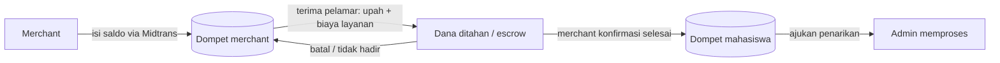

# Labor2Go

Marketplace tenaga kerja mikro yang mempertemukan **UMKM** (merchant) dengan **mahasiswa** untuk pekerjaan harian
berdurasi pendek (packing, kasir, cuci piring, event, dll.). Proyek mata kuliah Technopreneurship.

> Status: **prototipe**. Pembayaran memakai Midtrans **sandbox** (uang uji) dan penarikan saldo diproses manual oleh admin.

## Fitur

**Mahasiswa**: daftar dan lengkapi profil (NIM, KTM), jelajahi lowongan (cari, filter, urut), lamar, chat setelah diterima,
check-in/check-out, terima upah ke dompet, tarik saldo, beri ulasan.

**Merchant**: lengkapi profil usaha, isi saldo (Midtrans), pasang lowongan (dan simpan sebagai template "Panggil Ulang Cepat"),
terima pelamar (dana ditahan/escrow), konfirmasi selesai (upah cair), lapor tidak hadir (refund), batalkan lowongan (refund), ulasan.

**Admin**: verifikasi KTM dan foto usaha, proses penarikan saldo, statistik platform, pengguna, dan audit log.

## Teknologi

Next.js (App Router, TypeScript), Tailwind CSS, Supabase (PostgreSQL, Auth, Storage, Realtime), Midtrans Snap (sandbox), Vercel.

## Alur uang (escrow)



Semua perpindahan uang terjadi di database lewat fungsi atomik (satu transaksi, baris dikunci), bukan di kode aplikasi.

## Desain keamanan

- Row Level Security aktif di semua tabel, plus izin kolom (mis. user tidak bisa mengubah `role`, `verified`, atau saldo).
- Perubahan uang, status lamaran, check-in/out, ulasan, dan chat hanya lewat fungsi database (`accept_application`,
  `confirm_completion`, `cancel_job`, `send_message`, dst.); tidak bisa dimanipulasi dari browser.
- Top-up idempoten dan diverifikasi ke Midtrans (signature webhook + Status API); nominal dicocokkan dengan order.
- Foto KTM disimpan di bucket privat, ditampilkan ke admin lewat signed URL berumur 60 detik.
- Nomor HP tidak bisa dibaca langsung; hanya lewat fungsi yang memeriksa keterlibatan pada pekerjaan yang sudah diterima.
- Data identitas terkunci setelah akun terverifikasi. Tindakan admin tercatat di audit log.
- Kunci rahasia (service role, Midtrans server key) hanya di sisi server.

## Menjalankan secara lokal

Prasyarat: Node.js LTS, akun Supabase dan Midtrans sandbox.

```bash
npm install
cp .env.example .env.local   # isi variabel di bawah
npm run dev
```

Variabel lingkungan:

| Variabel | Keterangan |
|---|---|
| `NEXT_PUBLIC_SUPABASE_URL` | URL project Supabase |
| `NEXT_PUBLIC_SUPABASE_ANON_KEY` | Anon/publishable key |
| `SUPABASE_SERVICE_ROLE_KEY` | **Rahasia**, hanya server |
| `MIDTRANS_SERVER_KEY` | **Rahasia**, hanya server (sandbox: `SB-Mid-server-...`) |
| `NEXT_PUBLIC_MIDTRANS_CLIENT_KEY` | Client key sandbox |

## Menyiapkan database

Jalankan file di folder `supabase/` **berurutan** lewat Supabase SQL Editor:

`01_schema` → `02_schema_wallet` → `03_storage` → `04_fix_is_admin` → `05_grants` → `06_fix_rls_recursion` →
`07_jobs_feed` → `08_applications_guard` → `09_accept_escrow` → `10_work_cycle` → `11_wallet_ops` → `12_reviews` →
`13_admin` → `14_account` → `15_chat` → `16_lock_phone`

Catatan:
- Tabel baru di schema `public` tidak otomatis terbuka ke Data API; setiap tabel/view baru wajib diberi `GRANT` eksplisit dan RLS.
- Jadikan akun admin: `update public.profiles set role = 'admin' where id = '<uuid user>';`
- Webhook Midtrans (Settings → Payment → Notification URL): `https://<domain>/api/midtrans/notification`.

## Struktur folder

```
app/          halaman dan route handler (student, merchant, admin, jobs, chat, api, legal, help)
components/   komponen UI bersama
lib/          util (format, geo, pricing, verification, supabase client, midtrans)
hooks/        hook bersama (useNow, useAutoRefresh)
supabase/     seluruh SQL database (jalankan berurutan)
design/       referensi desain (Google Stitch), bukan bagian aplikasi
public/       logo dan aset statis
```

## Batasan dan rencana pengembangan

- Pembayaran sandbox; produksi butuh akun Midtrans resmi, legalitas usaha, dan payout otomatis.
- Penarikan saldo diproses manual oleh admin.
- Check-in belum divalidasi GPS; belum ada penyelesaian sengketa dan moderasi ulasan.
- Login Google dan WhatsApp OTP, notifikasi push, serta verifikasi email dengan SMTP khusus belum ada.
- Kualifikasi lowongan dan jam operasional merchant belum tersedia.